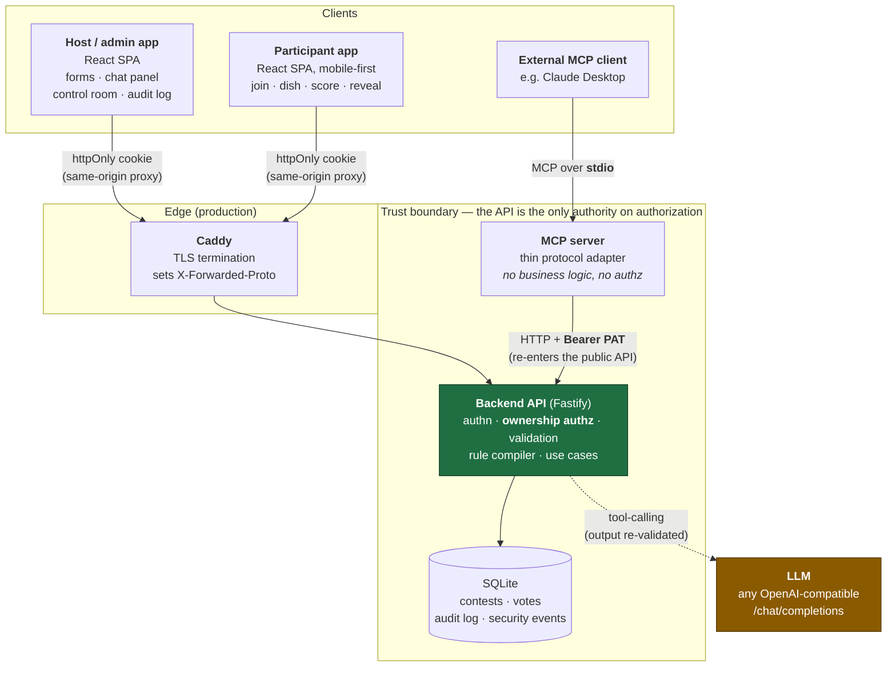
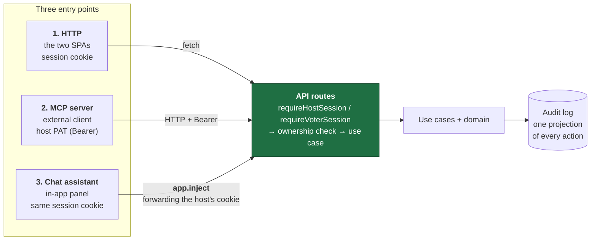
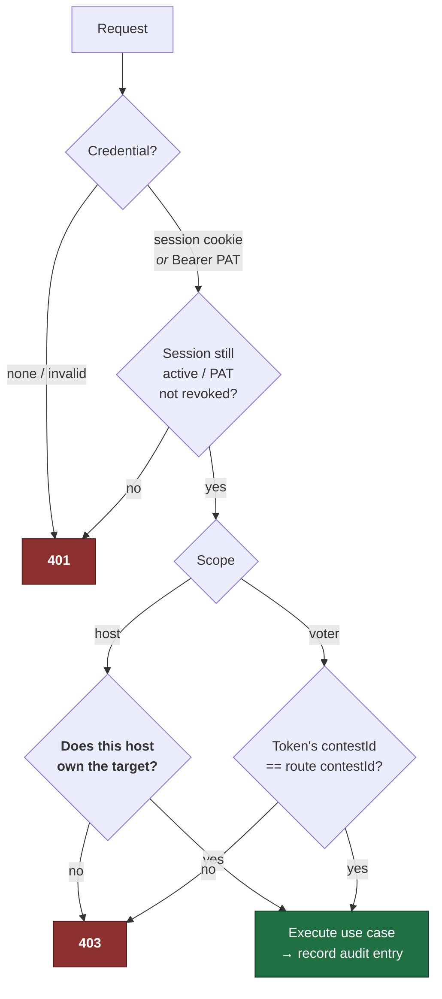
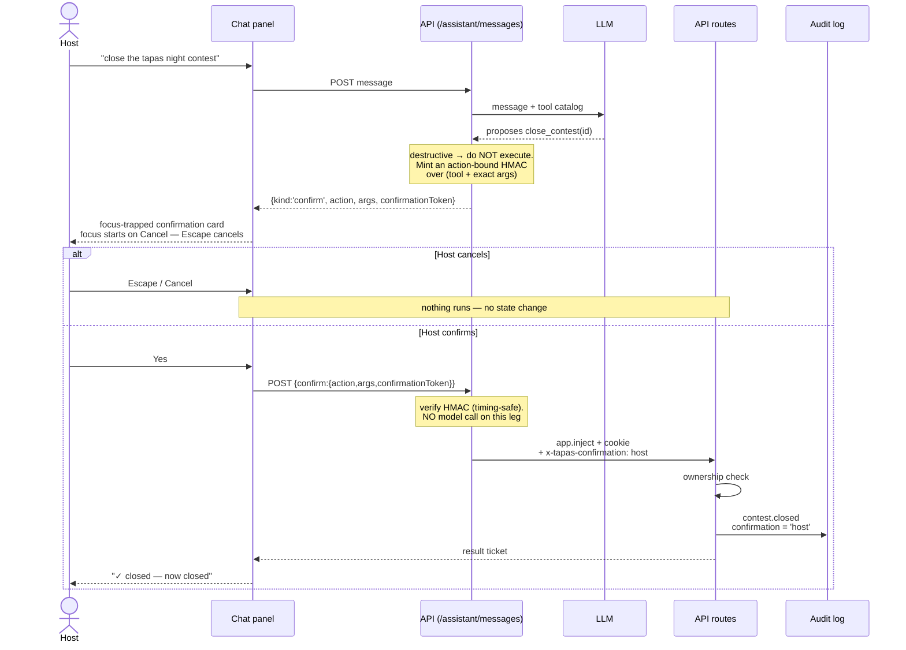
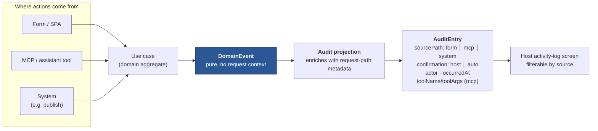
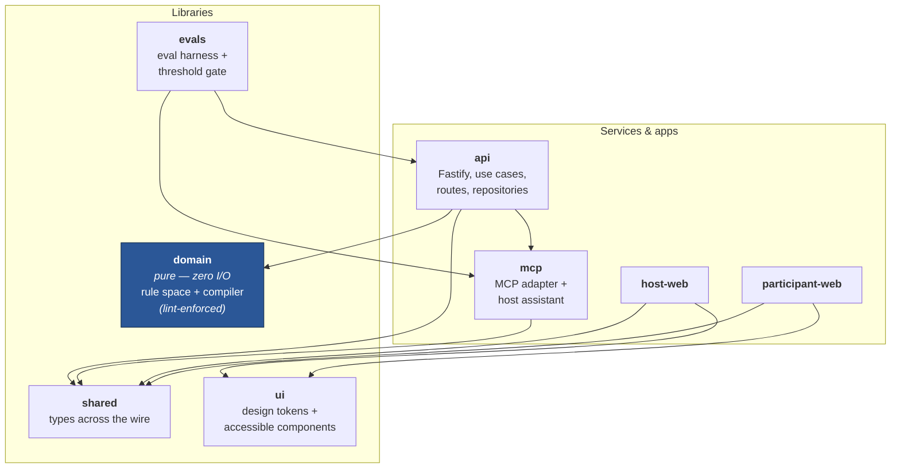
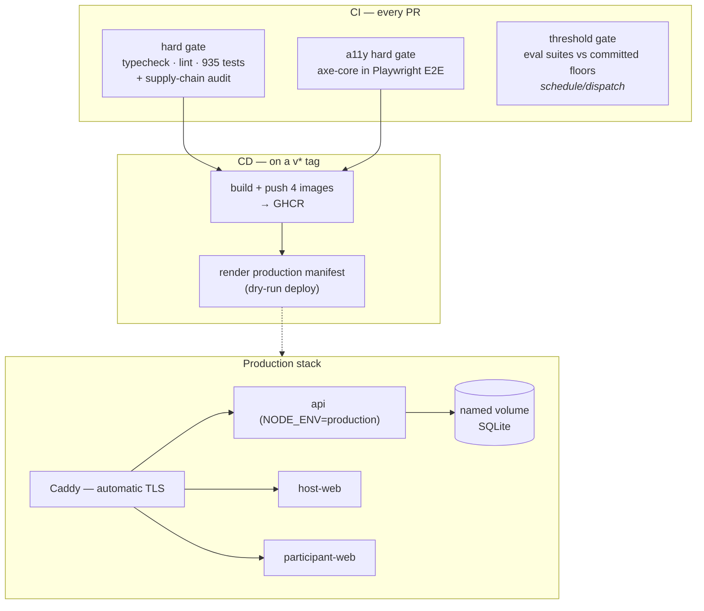

# Tapas — Architecture

*Defense artifact for task 6.7. The system in diagrams: the API, the MCP server,
the two frontends, the chat panel, and the audit log — plus the flows that carry
the thesis argument (one authorization authority, three entry points, every action
audited, destructive actions confirmed).*

Diagrams are [Mermaid](https://mermaid.js.org) and render natively on GitHub, so
they stay text-versioned and reviewable alongside the code.

---

## 1. System context

The one-screen view: who talks to what, and where the trust boundary sits.

**The load-bearing property:** every path — browser, external MCP client, or the
in-app assistant — ends up executing the *same* API routes, so authentication,
ownership checks, validation, and auditing happen **exactly once**, in one place.
The MCP server deliberately holds no business logic and makes no authorization
decision of its own; it is a protocol adapter that speaks to the API like any
other client.

---

## 2. The three entry points

Design.md §7 calls for three ways into the system. They converge by construction.

Entry point 3 is the subtle one: rather than re-implementing tool execution, the
in-app assistant **dispatches the chosen tool back through the same API** via
`app.inject`, forwarding the signed-in host's session cookie
([assistant-routes.ts](../packages/api/src/http/assistant-routes.ts)). One
execution path, so a rule can never be enforced in one entry point and missed in
another.

---

## 3. Authorization: the ownership check

`401` = not authenticated · `403` = authenticated but not permitted.

Role alone is never enough: a host operation verifies the host **owns** the target
contest or draft; a voter operation verifies the voter belongs to *that* contest.
See [threat-model.md §3.1](threat-model.md) for the code references.

---

## 4. Destructive actions: propose → confirm → act

The thesis centrepiece — "AI proposes, the host confirms". Nothing destructive
runs on the model's say-so.

Three properties make this more than a UI nicety:

1. **The token is action-bound.** It is an HMAC over the tool name *and* its exact
   arguments, so a token minted to close contest A cannot close contest B.
2. **The confirm leg runs no model.** It validates the token and dispatches —
   the model cannot influence what happens after the host says yes.
3. **The same gate exists on the MCP path.** An external MCP client gets
   `confirmationRequired` instead of execution
   ([mcp-server.ts](../packages/mcp/src/mcp-server.ts)), so the protection is a
   property of the system, not of one UI.

---

## 5. The audit log as an event projection

Every action, from every entry point, lands in **one** log.

The domain emits **pure events** that know nothing about HTTP; the application
layer projects them into `AuditEntry`, attaching the provenance the domain cannot
know ([audit-entry.ts](../packages/shared/src/audit/audit-entry.ts)). That is what
makes "who did this, through which path, and did a human confirm it?" answerable
for *every* action — including ones an AI proposed.

---

## 6. Package structure

`domain` has **zero I/O** — no DB, no network, no LLM — enforced by an ESLint rule,
which is what lets the rule compiler be tested as a pure function (including
property-based tests) with no infrastructure at all.

> Note the `api → mcp` edge: the API reuses the MCP tool catalog and HMAC gate for
> the in-app assistant. The reverse dependency (`mcp → api`) is **dev-only** (test
> harness), so there is no production cycle.

---

## 7. Deployment

Caddy is the single TLS edge and proxies the API path prefixes **directly** to the
API (setting `X-Forwarded-Proto: https`), so the API's production HTTPS redirect
does not loop and its `Secure` cookies ride a real TLS origin. Details and the
verification record are in [infra-generation.md](infra-generation.md).

---

## Related documents

- [threat-model.md](threat-model.md) — OWASP Top 10 mapping, with code references and named gaps
- [infra-generation.md](infra-generation.md) — how the Docker/compose/CI/CD artifacts were generated and verified
- [eval-trajectory.md](eval-trajectory.md) · [host-assistant-eval-trajectory.md](host-assistant-eval-trajectory.md) — the AI surfaces, measured
- [design.md](../openspec/changes/tapas-contest-app/design.md) — the full design record
